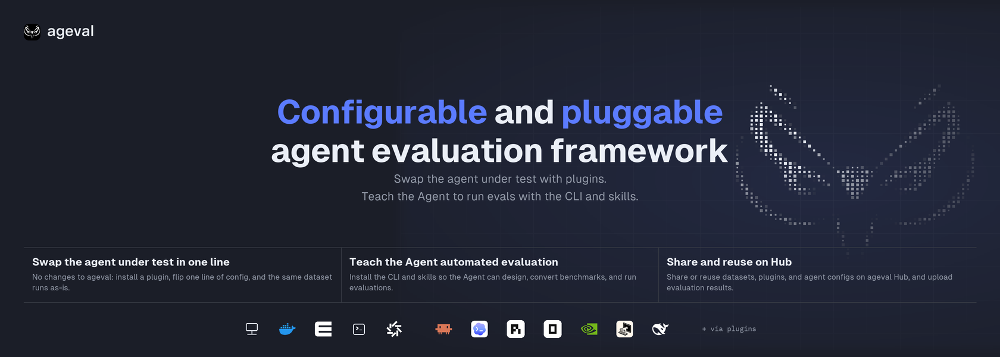
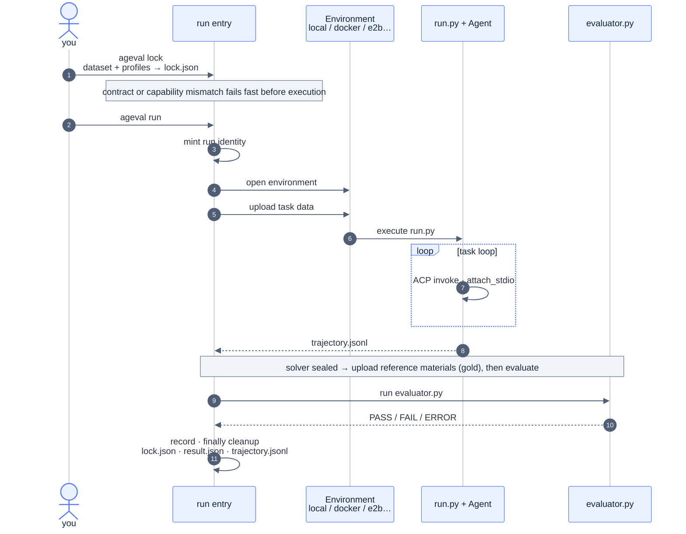

<div align="center"><a name="readme-top"></a>



# ageval

**English** · [简体中文](README.zh-CN.md)

<br/>

<!-- SHIELD GROUP -->

<a href="https://github.com/ZJU-REAL/ageval/stargazers"></a>
<a href="https://github.com/ZJU-REAL/ageval/releases"></a>
<a href="https://github.com/ZJU-REAL/ageval/actions/workflows/ci.yml"></a>
<a href="https://github.com/ZJU-REAL/ageval/blob/main/LICENSE"></a>
<a href="https://zju-real.github.io/ageval/en/docs/"></a>
<a href="#getting-started"></a>
<a href="https://youtu.be/MxiM9A9YvLc"></a>

</div>

<details>
<summary><kbd>Table of contents</kbd></summary>

#### TOC

- [⚡ Getting started](#getting-started)
  - [Install skills](#install-skills)
  - [Develop from source](#develop-from-source)
- [✨ Features](#features)
  - [Screenshots](#screenshots)
- [⚙️ How it works](#how-it-works)
  - [End-to-end flow](#end-to-end-flow)
  - [Resume an interrupted Attempt](#resume-an-interrupted-attempt)
  - [Core base](#core-base)
  - [Plugins](#plugins)
- [📁 Project structure](#project-structure)
- [📖 Docs](#docs)

<br/>

</details>

**ageval** combines programmable task scripts with declarative plugin composition, and records each step of a long-running Attempt in an activity log and checkpoints so an interruption resumes that same Attempt. Install the CLI and skills so a coding agent can author or convert a benchmark and run evaluations end to end; publish datasets, plugins, Agent packages, and evaluation results to the Hub for reproducible comparison and reuse.

<p align="center">
  
  <br>
  Framework: datasets and tasks, plugin composition, environments, and durable Attempt state
</p>

<p align="center">
  <video src="https://github.com/user-attachments/assets/79f54d94-999f-44c1-b2a4-72d79d3ce1f4" controls width="100%" title="ageval highlights"></video>
</p>

## Getting started

```bash
uv tool install ageval-cli
# install everything, or only what you need
uv tool install 'ageval-cli[all]' # every CLI extra (not the Hub service)
uv tool install 'ageval-cli[e2b]' # one extra at a time

ageval -V
```

Run a dataset directly from the Hub ([ageval.zjureal.com](https://ageval.zjureal.com), the CLI default) or from any local dataset directory:

```bash
ageval registry list                        # datasets visible on the Hub
ageval run official/minimal-demo@0.1.3 --task terminal-jsonl-agg
ageval run <org>/<name>@<version> --task <task-id>
ageval executors -v
ageval view <org>/<name>@<version> --no-browser

# continue one Attempt that stopped before result.json
ageval run <dataset> --task <id> --resume <attempt_id>
# a suite recovers an unfinished slot in place
ageval run <dataset> --resume-suite <suite_run_id>
```

### Install skills

Install skills for your local coding agent (CLI usage, plugin authoring, dataset conversion, and SDK usage):

```bash
# install all
npx skills add ZJU-REAL/ageval
# install specific ones
npx skills add ZJU-REAL/ageval --skill ageval-cli
```

### Develop from source

To run the in-repo dataset examples and Agent packages, or to build from source, clone the repository:

```bash
git clone https://github.com/ZJU-REAL/ageval.git
cd ageval
uv sync --frozen --all-packages
uv run ageval -V
```

Run the minimal example and inspect the results in the local Viewer:

```bash
uv run ageval tasks examples/datasets/minimal-demo
uv run ageval run  examples/datasets/minimal-demo --task terminal-jsonl-agg
uv run ageval view examples/datasets/minimal-demo --no-browser
```

<div align="right">

[![][back-to-top]](#readme-top)

</div>

## Features

**Swap the evaluated agent and environment via plugins**

Environments and agent executors both connect through plugin slots. Coding agents connect by default over [ACP](https://agentclientprotocol.com) (`pi`, `codex`, `claude-code`, `opencode`), while [nooa](https://github.com/NVIDIA-NeMo/labs-OO-Agents), [dsh](https://github.com/deepseek-ai/deepseek-harness), [miniswe](https://github.com/SWE-agent/mini-swe-agent), and [OpenHands](https://docs.openhands.dev/sdk) use the same plugin mechanism. Update `profiles.yaml` or pass `--agent` (and optional `--model`) to switch configurations without modifying task scripts.

**Automated benchmark conversion and inspection**

With the CLI and skills installed, a coding agent can author or convert a dataset and execute evaluations end to end. Afterwards, `ageval view` opens the dataset (or a directory of datasets) to inspect phase timings, tool-call trajectories, and reproduction commands locally, while `ageval results regrade` re-runs grading on archived artifact snapshots without repeating model inference.

**Resume a long-running Attempt from the last completed step**

ageval appends each step to an activity log and checkpoints the workspace and agent home before that step's effect settles. An Attempt that never wrote `result.json` continues in place with `--resume`, or inside a suite with `--resume-suite`. A settled Attempt stays immutable.

**Isolated phase boundary and flexible grading**

Only the independent `evaluator.py` in the `evaluate` phase can return `PASS` or `FAIL`, after solver sessions are sealed and reference materials (`gold`) are uploaded:

- **Deterministic scripts:** compare candidate artifacts or environment states against reference materials, optionally returning structured `checks`.
- **Agent-as-judge / LLM-as-judge:** bind an independent `judge` profile in `profiles.yaml` to inspect artifacts across single or multiple steps.

**Share and compare on Hub**

Publish datasets, plugins, Agent packages, and suite results to [ageval Hub](https://ageval.zjureal.com), or share a read-only snapshot link `/s/{token}` (frozen or `--live`) directly from a local run. Leaderboard entries record the bound harness, model, and environment and link directly to per-Attempt configurations and trajectories.

### Screenshots

<p align="center"></p>
<p align="center">Leaderboard: scores by Agent and model</p>

<p align="center"></p>
<p align="center">Trajectory: replay tool calls in the local viewer</p>

<details>
<summary>More screenshots</summary>
<br/>

<p align="center"></p>
<p align="center">Agents: packages you can pull from Hub</p>

<p align="center"></p>
<p align="center">Plugin marketplace: environment and agent runtime plugins</p>

<p align="center"></p>
<p align="center">Pareto: pass rate vs time</p>

<p align="center"></p>
<p align="center">Verifier: deterministic script checks</p>

</details>

<div align="right">

[![][back-to-top]](#readme-top)

</div>

## How it works

### End-to-end flow

1. **`ageval lock`** resolves the plugin dependency graph (`ExtensionGraph`), validates capability dependencies and `ModelSpec` contracts, and writes `lock.json` (storing credentials only as environment variable locators).
2. **`ageval run`** provisions the selected environment (`local`, `docker`, `e2b`, `ssh`, or `daytona`) and uploads task input data.
3. **`run.py`** drives the task interaction loop inside the `run` phase; switching environments or harnesses requires no changes to task code.
4. **`evaluator.py`** runs in the `evaluate` phase after solver sessions are sealed and reference materials (`gold`) are uploaded, producing the sole `PASS` or `FAIL` verdict while `cleanup` always executes in `finally`.



### Resume an interrupted Attempt

A long task spends many model and tool turns inside one Attempt. If the parent process is killed before `result.json` is written, those completed turns and the workspace are still on disk. ageval appends every step to `.ageval/runs/<attempt_id>/activity.jsonl` and stores a checkpoint of `/attempt/workspace` and `/attempt/home` when the step settles.

`--resume` continues that Attempt when `result.json` is absent and the locked configuration digest still matches. `--resume-suite` does the same for an unfinished suite slot, and still skips slots that already settled as `PASS`, `FAIL`, or `ERROR`. If the environment is still running the Attempt, the command exits without writing `result.json`.

A live environment that still matches the last completed step is reused. A lost environment is started again and restored from the latest checkpoint. `openai-http`, `anthropic-http`, `miniswe`, and `terminus-2` rebuild the next model context from the activity log. `acp`, OpenHands, and dsh resume the session stored under the attempt home. `nooa` has no native session and continues from the logged transcript. Calls that already completed are not executed again, and the wall-clock time and invocation count already spent stay charged. A settled Attempt is immutable: `--retry-errors` and `--replace-slot` allocate a new Attempt.

### Core base

ageval Core coordinates a fixed pipeline: `lock → environment → run → evaluate → record`, with resource `cleanup` in `finally`. During `ageval lock`, Core binds the environment plugin and per-role executor plugins and validates their contracts. At runtime, Core enforces `limits` (wall-clock timeouts, invocation quotas, and concurrency caps) prior to execution and archives structured evidence (`lock.json`, `result.json`, `trajectory.jsonl`, `summary.json`, and `task-artifacts/`). An Attempt that has not settled also keeps `activity.jsonl` and `checkpoints/` so `--resume` can continue it.

<p align="center">
  
</p>

### Plugins

Core decouples runtime responsibilities through **exclusive slots**, **chain slots**, and declarative **dependency injection** (`inject`). Plugins declare the slots they implement and the service capabilities they require; `ageval lock` resolves and verifies the dependency graph (`ExtensionGraph`) before execution.

```yaml
# Agent executor plugin (e.g. dsh)
plugin_id: dsh
slots:
  exclusive:
    - id: executor
inject:
  - service: environment
    capabilities: [exec, upload]

# Environment plugin (e.g. docker)
plugin_id: docker
slots:
  exclusive:
    - id: environment
```

<p align="center">
  
</p>

<div align="right">

[![][back-to-top]](#readme-top)

</div>

## Project structure

```text
ageval/
├── src/ageval/
│   ├── cli/                         # argv, help, exit code
│   ├── application/
│   │   ├── composition.py           # sole production wiring; CLI imports build_* here
│   │   ├── lock.py                  # load_and_lock
│   │   ├── run.py                   # mint identity → run_attempt
│   │   ├── regrade.py               # artifact-based regrading (skips run phase)
│   │   ├── campaign.py / suite/     # matrix · suite · Always-k
│   │   └── agent_ops/ / plugin_ops / registry_ops/ / analysis/
│   ├── attempt/                     # Attempt pipeline
│   │   ├── __init__.py              # run_attempt & run_regrade
│   │   └── phases/                  # environment → run → evaluate → record · cleanup
│   ├── config/                      # dataset + task.yaml + profiles
│   ├── model/                       # ModelSpec · resolve_model
│   ├── environments/protocol.py     # EnvironmentProvider · capabilities
│   ├── plugins/
│   │   ├── base.py / decorators.py  # BaseEnvironment · BaseExecutor
│   │   ├── slots.py                 # exclusive / chain slots
│   │   └── contrib/                 # acp · local · docker/attempt · e2b · daytona · ssh · openai_http · anthropic_http
│   ├── runtime/                     # identity, parent Agent Service, task_worker
│   ├── evaluation/                  # bind_evaluation
│   └── evidence/                    # .ageval/runs layout, activity log, checkpoints, trajectory sealing
├── src/ageval_sdk/                  # ageval_sdk for run.py and evaluator.py
├── plugins/                         # external ageval.plugin/1 (nooa, dsh, miniswe, openhands, acp-oneshot, …)
├── examples/
│   ├── datasets/
│   │   ├── minimal-demo/            # terminal-jsonl-agg · tau2-dialog-min · multiagent-env-min
│   │   ├── concurrent-research/     # concurrent-session fanout example
│   │   └── tau3-airline-5/          # airline-00 … airline-04
│   └── agents/                      # ageval.agent/1 packages
├── apps/shared                      # shared Hub + Viewer UI components
├── apps/viewer                      # ageval view SPA
├── apps/hub                         # Hub SPA
├── services/registry/               # package + results HTTP service & hosted worker
├── docs/                            # mechanism design specifications
└── website/                         # bilingual product documentation
```

<div align="right">

[![][back-to-top]](#readme-top)

</div>

## Docs

- Usage: [docs site](https://zju-real.github.io/ageval/en/docs/) ([source](website/))
- Design: [`docs/`](docs/README.md)
- Examples: [`examples/README.md`](examples/README.md)
- [`AGENTS.md`](AGENTS.md)
- [`ARCHITECTURE.md`](ARCHITECTURE.md)

<div align="right">

[![][back-to-top]](#readme-top)

</div>

<!-- LINK GROUP -->

[back-to-top]: https://img.shields.io/badge/-↑_BACK_TO_TOP-1B54E8?style=flat-square
