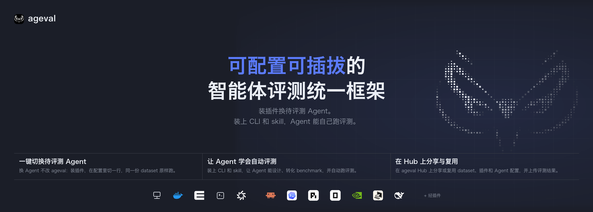
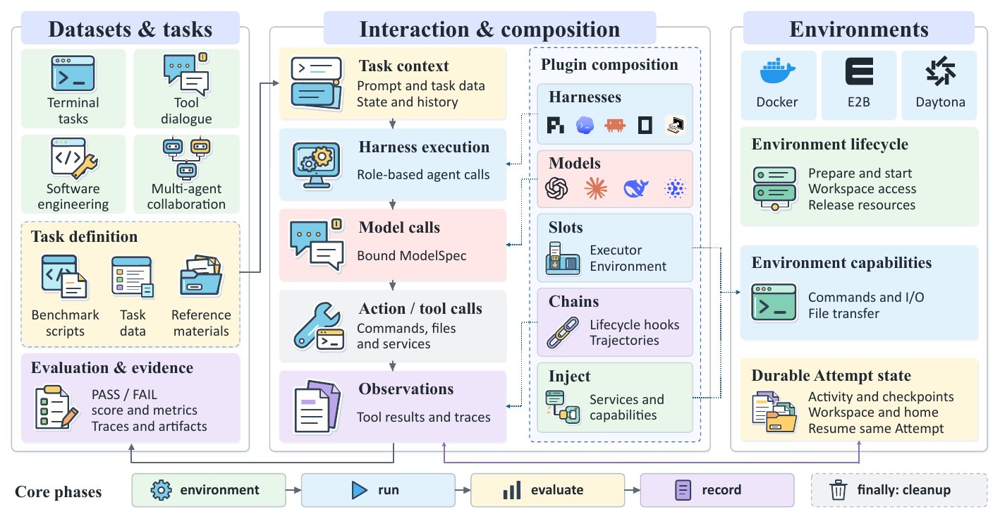
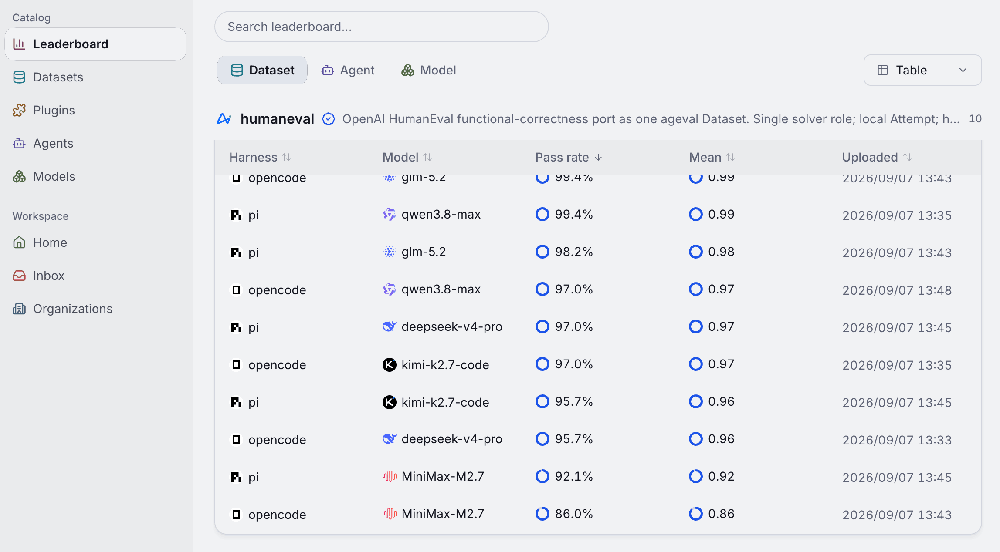
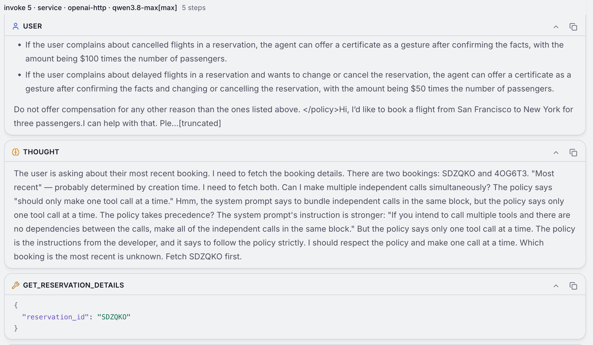
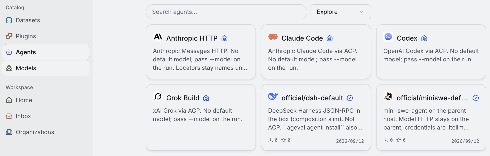
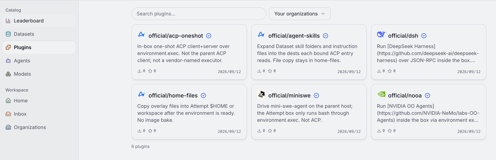
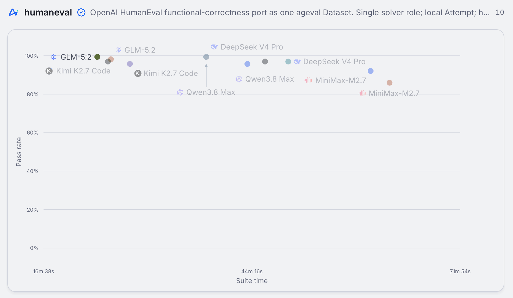
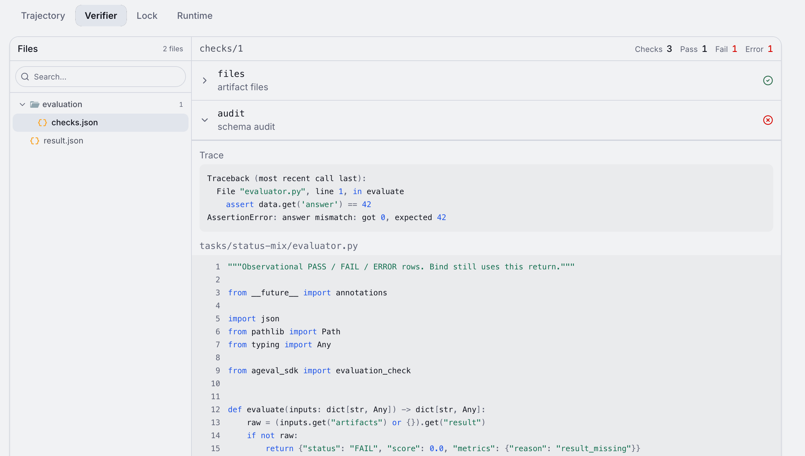
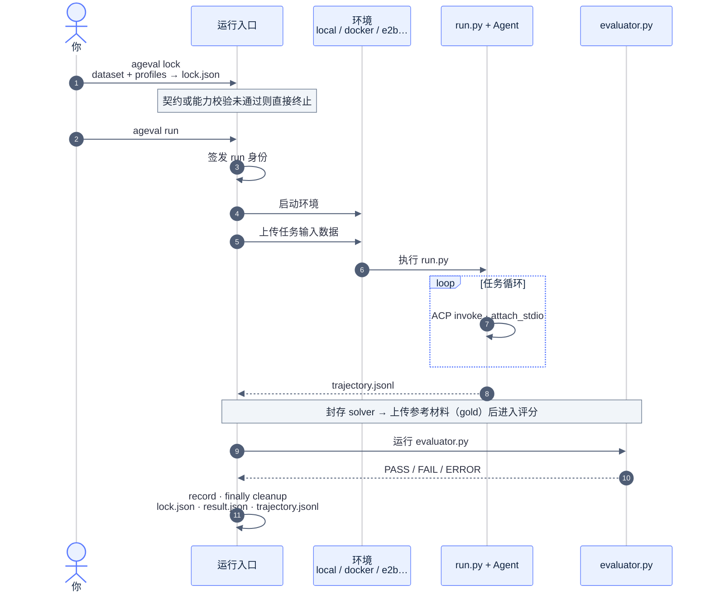

<div align="center"><a name="readme-top"></a>



# ageval

[English](README.md) · **简体中文**

<br/>

<!-- SHIELD GROUP -->

<a href="https://github.com/ZJU-REAL/ageval/stargazers"></a>
<a href="https://github.com/ZJU-REAL/ageval/releases"></a>
<a href="https://github.com/ZJU-REAL/ageval/actions/workflows/ci.yml"></a>
<a href="https://github.com/ZJU-REAL/ageval/blob/main/LICENSE"></a>
<a href="https://zju-real.github.io/ageval/zh-CN/docs/"></a>
<a href="#快速开始"></a>
<a href="https://youtu.be/MxiM9A9YvLc"></a>

</div>

<details>
<summary><kbd>目录</kbd></summary>

#### TOC

- [⚡ 快速开始](#快速开始)
  - [安装 skills](#安装-skills)
  - [从源码开发](#从源码开发)
- [✨ 功能](#功能)
  - [截图](#截图)
- [⚙️ 如何运行](#如何运行)
  - [整体流程](#整体流程)
  - [断点恢复](#断点恢复)
  - [基座总览](#基座总览)
  - [插件接入](#插件接入)
- [📁 目录结构](#目录结构)
- [📖 文档](#文档)

<br/>

</details>

**ageval** 将可编程任务脚本与声明式插件组合相结合，并用活动日志和检查点记下长程 Attempt 的每一步，中断后从断点恢复同一次运行。安装 CLI 和 skill 后，coding agent 可自行编写或转换 benchmark 并执行评测；评测结果、dataset、插件与 Agent 包均可发布至 Hub 共享与复用。

<p align="center">
  
  <br>
  框架说明：任务与数据、插件组合、执行环境，以及可恢复的 Attempt 状态
</p>

<p align="center">
  <video src="https://github.com/user-attachments/assets/79f54d94-999f-44c1-b2a4-72d79d3ce1f4" controls width="100%" title="ageval highlights"></video>
</p>

## 快速开始

```bash
uv tool install ageval-cli
# 装全依赖或者按需安装
uv tool install 'ageval-cli[all]' # CLI 可选后端一次装全（不含 Hub 服务）
uv tool install 'ageval-cli[e2b]' # 按需装单个 extra

ageval -V
```

直接运行 Hub 上的 dataset（[ageval.zjureal.com](https://ageval.zjureal.com)，CLI 默认源），或运行任意本地 dataset 根目录：

```bash
ageval registry list                        # 查看 Hub 上可见的 dataset
ageval run official/minimal-demo@0.1.3 --task terminal-jsonl-agg
ageval run <org>/<name>@<version> --task <task-id>
ageval executors -v
ageval view <org>/<name>@<version> --no-browser

# 继续一次尚未写出 result.json 的 Attempt
ageval run <dataset> --task <id> --resume <attempt_id>
# suite 就地恢复尚未结束的槽位
ageval run <dataset> --resume-suite <suite_run_id>
# 列出保留的切点，再从其中一个新开一次 Attempt
ageval checkpoints <dataset> --run <attempt_id>
ageval run <dataset> --task <id> --fork <attempt_id> --checkpoint <seq> --model <model_id>
```

### 安装 skills

为本机 coding agent 安装 skills（涵盖 CLI 使用、插件开发、dataset 编写与 SDK 调用）：

```bash
# 安装全部
npx skills add ZJU-REAL/ageval
# 指定安装
npx skills add ZJU-REAL/ageval --skill ageval-cli
```

### 从源码开发

如需运行仓库内的 dataset 示例与 Agent 包，或从源码构建，请克隆仓库：

```bash
git clone https://github.com/ZJU-REAL/ageval.git
cd ageval
uv sync --frozen --all-packages
uv run ageval -V
```

运行仓库内的最小示例并在本地 Viewer 中查看结果：

```bash
uv run ageval tasks examples/datasets/minimal-demo
uv run ageval run  examples/datasets/minimal-demo --task terminal-jsonl-agg
uv run ageval view examples/datasets/minimal-demo --no-browser
```

<div align="right">

[![][back-to-top]](#readme-top)

</div>

## 功能

**通过插件切换待测 Agent 与环境**

执行环境与 Agent 执行器（executor）均通过插件槽接入。Coding agent 默认经 [ACP](https://agentclientprotocol.com)（`pi`、`codex`、`claude-code`、`opencode`）接入；[nooa](https://github.com/NVIDIA-NeMo/labs-OO-Agents)、[dsh](https://github.com/deepseek-ai/deepseek-harness)、[miniswe](https://github.com/SWE-agent/mini-swe-agent) 与 [OpenHands](https://docs.openhands.dev/sdk) 同样通过插件接入。修改 `profiles.yaml` 或通过 `--agent`（配合可选 `--model`）即可切换待测配置，无需改动任务脚本。

**支持 Agent 自主转换与结果核查**

安装 CLI 和 skill 后，coding agent 可按规范编写或转换 dataset 并端到端完成评测。运行结束后，使用 `ageval view` 打开单个或多个 dataset 目录，即可在本地查看各阶段耗时、工具调用轨迹与失败复现命令；迭代评分逻辑时，还可使用 `ageval results regrade` 基于已保存的产物快照直接重新评分，无需重跑模型。

**长程任务可从上次完成的步骤恢复**

ageval 在每一步产生外部效果之前写入活动日志，并保存工作区与 Agent home 的检查点。尚未写出 `result.json` 的 Attempt 用 `--resume` 原地继续；suite 中用 `--resume-suite`。已经封存的 Attempt 保持不变。`--keep-recovery-state` 留下活动日志和检查点后，`ageval run --fork` 可以从一个切点新开一次 Attempt，换求解模型，harness 仍是源 Attempt 锁定的那个。

**严格的阶段边界与双评分策略**

系统将执行（`run`）与评分（`evaluate`）划分为独立阶段，封存 solver 会话后再上传参考材料（`gold`），且 `PASS` 或 `FAIL` 仅由独立的 `evaluator.py` 给出：

- **确定性脚本：** 比对任务产物或环境状态与参考材料，支持返回分步检查项 `checks`。
- **Agent-as-judge / LLM-as-judge：** 在同一份 `profiles.yaml` 中配置独立的 `judge` 角色，在评分阶段执行单步或多步工具验证。

**在 Hub 上共享与对比**

将 dataset、插件、Agent 包和评测结果发布至 [ageval Hub](https://ageval.zjureal.com)，也可将本地正在运行或已完成的 suite / Attempt 生成只读快照链接 `/s/{token}`（支持静态定格或 `--live` 实时更新），无需登录即可查阅。排行榜清晰记录每次评测绑定的 harness、模型与环境，并支持逐级下钻查看单题锁定配置与执行轨迹。

### 截图

<p align="center"></p>
<p align="center">Leaderboard：不同 Agent 与模型下的评测成绩</p>

<p align="center"></p>
<p align="center">轨迹：本地查看器回放工具调用</p>

<details>
<summary>更多截图</summary>
<br/>

<p align="center"></p>
<p align="center">Agent：Hub 上可拉取的 Agent 包</p>

<p align="center"></p>
<p align="center">插件市场：环境与 Agent 运行时插件</p>

<p align="center"></p>
<p align="center">Pareto：通过率相对耗时</p>

<p align="center"></p>
<p align="center">Verifier：确定性脚本 checks</p>

</details>

<div align="right">

[![][back-to-top]](#readme-top)

</div>

## 如何运行

### 整体流程

1. **`ageval lock`** 解析插件依赖图（`ExtensionGraph`），静态校验能力依赖与 `ModelSpec` 模型参数契约，生成 `lock.json`（密钥仅保留环境变量名引用）。
2. **`ageval run`** 启动选定环境（`local`、`docker`、`e2b`、`ssh` 或 `daytona`）并上传任务输入数据。
3. **`run.py`** 在 `run` 阶段驱动任务交互循环；更换环境或待测 Agent 无需修改此文件。
4. **`evaluator.py`** 在 solver 封存、参考材料（`gold`）上传后进入 `evaluate` 阶段独立给出 `PASS` 或 `FAIL`，并在 `finally` 中始终执行 `cleanup`。



### 断点恢复

长程任务会在同一次 Attempt 里走很多轮模型调用和工具调用。父进程在写出 `result.json` 之前被杀掉时，已经完成的轮次和工作区仍留在磁盘上。ageval 把每一步追加到 `.ageval/runs/<attempt_id>/activity.jsonl`，并在该步落定时为 `/attempt/workspace` 和 `/attempt/home` 保存检查点。

`--resume` 仅在 `result.json` 尚不存在、且锁定配置的摘要仍然一致时，继续这同一次 Attempt。`--resume-suite` 对 suite 里尚未结束的槽位做同样的事，已经以 `PASS`、`FAIL` 或 `ERROR` 结束的槽位仍然跳过。环境若还在跑这次 Attempt，命令直接退出，不写 `result.json`。

仍与最后完成步骤对齐的环境会被原地接回。环境已经丢失时，会重新启动并从最近的检查点恢复。`openai-http`、`anthropic-http`、`miniswe` 和 `terminus-2` 从活动日志重建下一轮模型上下文。`acp`、OpenHands 和 dsh 恢复 Attempt home 里保存的会话。`nooa` 没有原生会话，从已记录的对话继续。已经完成的调用不会再执行一次，已经消耗的墙钟时间和调用次数仍然计入限额。已经封存的 Attempt 不可改写：`--retry-errors` 和 `--replace-slot` 会分配一次新的 Attempt。

`--keep-recovery-state` 在 `result.json` 和 `trajectory.jsonl` 都写出之后仍保留 `activity.jsonl` 与 `checkpoints/`。`ageval checkpoints` 列出这些切点。`ageval run --fork --checkpoint --model` 从一次已完成的 run 阶段切点新开 Attempt，使用新的环境、源 harness 和新的求解模型。父 Attempt 保持封存。默认 pass@k 不计入这次子 Attempt。

### 基座总览

ageval Core 统一管理固定阶段流水线：`lock → environment → run → evaluate → record`，并在 `finally` 中无条件执行环境清理（`cleanup`）。在 `ageval lock` 阶段，系统解析环境插件与各角色的 executor 插件并校验契约；在运行阶段，Core 在调用前强制执行 `limits` 资源与配额上限，并将配置绑定、评分结果、交互轨迹与产物快照归档至 evidence 目录（`lock.json`、`result.json`、`trajectory.jsonl`、`summary.json` 及 `task-artifacts/`）。尚未封存的 Attempt 还会保留 `activity.jsonl` 和 `checkpoints/`，供 `--resume` 继续。封存之后，`--keep-recovery-state` 留下同一份恢复文件，供之后的 `--fork` 读取。

<p align="center">
  
</p>

### 插件接入

Core 通过**独占槽**（`exclusive slot`）、**链槽**（`chain slot`）与声明式**依赖注入**（`inject`）组合底层组件。插件声明自身实现的槽位及所需的服务能力，由 `ageval lock` 在运行前解析并校验依赖图（`ExtensionGraph`）。

```yaml
# Agent 插件（如 dsh）
plugin_id: dsh
slots:
  exclusive:
    - id: executor
inject:
  - service: environment
    capabilities: [exec, upload]

# 环境插件（如 docker）
plugin_id: docker
slots:
  exclusive:
    - id: environment
```

<p align="center">
  
</p>

<div align="right">

[![][back-to-top]](#readme-top)

</div>

## 目录结构

```text
ageval/
├── src/ageval/
│   ├── cli/                         # 参数、帮助、退出码
│   ├── application/
│   │   ├── composition.py           # 生产装配唯一入口；CLI 仅 import 此处的 build_*
│   │   ├── lock.py                  # load_and_lock
│   │   ├── run.py                   # 签发身份 → run_attempt
│   │   ├── regrade.py               # 基于产物快照的重新评分（跳过 run 阶段）
│   │   ├── campaign.py / suite/     # 矩阵 · suite · Always-k
│   │   └── agent_ops/ / plugin_ops / registry_ops/ / analysis/
│   ├── attempt/                     # 单次 Attempt 流水线
│   │   ├── __init__.py              # run_attempt 与 run_regrade
│   │   └── phases/                  # environment → run → evaluate → record · cleanup
│   ├── config/                      # dataset + task.yaml + profiles
│   ├── model/                       # ModelSpec · resolve_model
│   ├── environments/protocol.py     # EnvironmentProvider · 能力标记
│   ├── plugins/
│   │   ├── base.py / decorators.py  # BaseEnvironment · BaseExecutor
│   │   ├── slots.py                 # exclusive / chain 插件槽
│   │   └── contrib/                 # acp · local · docker/attempt · e2b · daytona · ssh · openai_http · anthropic_http
│   ├── runtime/                     # 身份、父进程 Agent Service、task_worker
│   ├── evaluation/                  # bind_evaluation
│   └── evidence/                    # .ageval/runs 目录、活动日志、检查点与轨迹封存
├── src/ageval_sdk/                  # 任务脚本使用的 ageval_sdk
├── plugins/                         # 外置 ageval.plugin/1（nooa、dsh、miniswe、openhands、acp-oneshot 等）
├── examples/
│   ├── datasets/
│   │   ├── minimal-demo/            # terminal-jsonl-agg · tau2-dialog-min · multiagent-env-min
│   │   ├── concurrent-research/     # 多会话并发示例
│   │   └── tau3-airline-5/          # airline-00 … airline-04
│   └── agents/                      # ageval.agent/1 配置包
├── apps/shared                      # Hub + Viewer 共用组件与令牌
├── apps/viewer                      # ageval view 本地 SPA
├── apps/hub                         # Hub SPA
├── services/registry/               # 包与结果 HTTP 服务及后台 hosted worker
├── docs/                            # 机制设计文档
└── website/                         # 双语产品文档站
```

<div align="right">

[![][back-to-top]](#readme-top)

</div>

## 文档

- 用法：[文档站](https://zju-real.github.io/ageval/zh-CN/docs/)（[源码](website/)）
- 设计：[docs/](docs/README.md)
- 示例：[examples/README.md](examples/README.md)
- [AGENTS.md](AGENTS.md)
- [ARCHITECTURE.md](ARCHITECTURE.md)

<div align="right">

[![][back-to-top]](#readme-top)

</div>

<!-- LINK GROUP -->

[back-to-top]: https://img.shields.io/badge/-↑_回到顶部-1B54E8?style=flat-square
