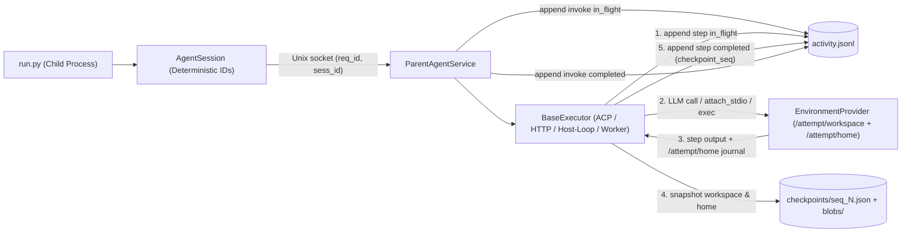
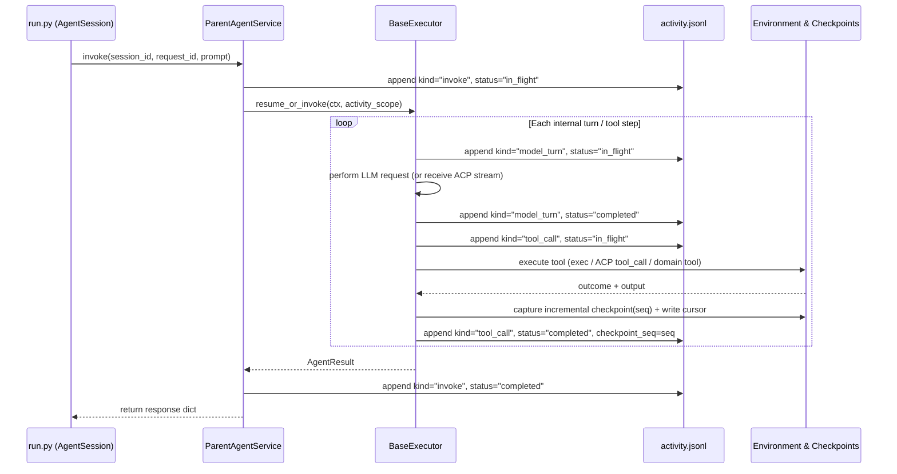
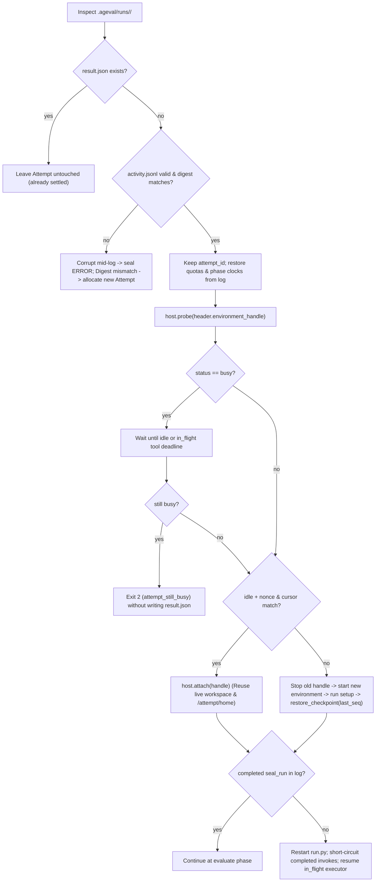
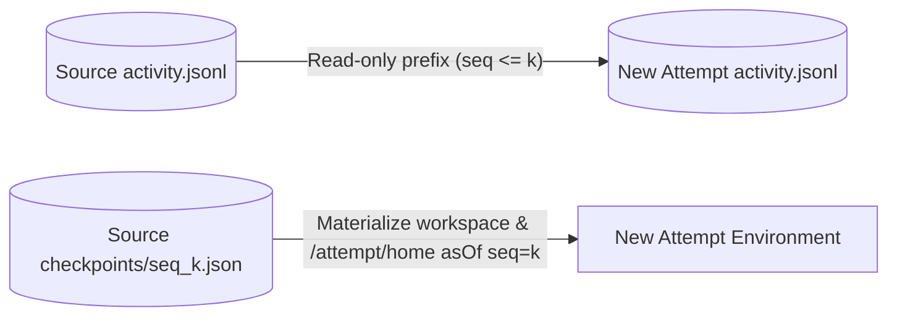

# Recover an unsealed Attempt via unified activity log and workspace checkpoints

| Field | Value |
| --- | --- |
| Status | Accepted |
| Date | 2026-10-25 |
| Decides | `.ageval/runs/<attempt_id>/activity.jsonl` (`ageval.activity/1`) and `.ageval/runs/<attempt_id>/checkpoints/` (`ageval.checkpoint/1`) form the authoritative durability store for an unsealed Attempt. Recovery preserves the `attempt_id` when `result.json` is absent and the lock digest matches. Every `BaseExecutor` streams step boundaries into `activity.jsonl` and restores context on recovery either by projecting `activity.jsonl` (including `compaction` records) or by resuming its native session journal under `/attempt/home` (covering `acp`, `openhands`, `dsh`, `nooa`, `miniswe`, `terminus-2`, `openai-http`, and `anthropic-http`). `EnvironmentProvider` adds `probe(handle)` and `attach(handle)` paired with incremental `/attempt/{workspace,home}` checkpoints so live environments are reused in place and lost environments are restored to the exact step snapshot without fragile bash stdout matching. |
| Does not decide | The CLI command and selection UX for `fork`. A fork creates a new Attempt from a chosen historical `seq`; it consumes the `activity.jsonl` prefix and `checkpoints/seq_<N>.json` snapshot defined in this RFC. |

The rules in this RFC are folded into the design pages listed in the final section.

---

## 1. Motivation and Current Limitations

An **Attempt** is a single execution of one task under a locked configuration, stored under `<dataset>/.ageval/runs/<attempt_id>/`. A **suite** executes all tasks in a dataset and indexes its slots under `<dataset>/.ageval/suite-runs/<suite_run_id>/`. The word **jobs** refers exclusively to the run list in Hub and Viewer.

### 1.1 How Attempt execution and resume work today

Today, `ageval run --task` mints three identifiers once per Attempt via `IdentityFactory`: `new_run` creates the run identifier, `new_trial` binds the run to `locked_config_digest`, and `new_attempt` creates the Attempt identifier and directory. Each Attempt executes a fixed phase sequence defined in `src/ageval/attempt/__init__.py`:

1. `environment`: calls `host.start`, uploads `data/` into `/attempt/workspace`, and emits `after_environment_ready` (HOME config overlays and ACP runtime checks) followed by `environment_setup` (`environment/setup.sh`).
2. `run`: launches `run.py` in an isolated child process. Role session calls cross a Unix domain socket to `ParentAgentService` in the parent process. At the end of `run`, `seal_run` cancels queued solver calls, drains in-flight solver calls, marks solver writers stopped, and snapshots declared task artifacts into `task-artifacts/`.
3. `evaluate`: uploads `evaluation/` reference materials (`gold`) and runs `evaluator.py` to bind `PASS` or `FAIL` into `result.json`.
4. `record`: runs in `finally` once the environment has started, invoking `trajectory_collect`, `trajectory_enrich`, and `trajectory_seal` to write `trajectory.jsonl` and `summary.json`.
5. `cleanup`: runs in `finally` to stop any isolated scoring environments and call `host.stop`.

When an Attempt finishes normally or with a handled phase error, it writes `result.json`. Once `result.json` exists, the Attempt directory is immutable: `--retry-errors`, `--replace-slot`, and `ageval results regrade` always allocate a new Attempt and move the previous Attempt reference into `previous[]` on the suite slot.

### 1.2 What breaks when the parent process dies mid-Attempt

If the `ageval` parent process is terminated abruptly (`kill -9`, host reboot, OOM kill, or SSH/session drop) before `result.json` is written:

1. **Unsealed work is abandoned**: `--resume-suite` treats only slots with a settled `result.json` (`PASS`, `FAIL`, or `ERROR`) as finished. A slot whose Attempt died mid-run has no `result.json`, so `--resume-suite` allocates a brand-new Attempt and discards all completed LLM turns, tool executions, and token spend in the interrupted directory.
2. **Orphaned environments are not reclaimed or reused**: Because `finally` never ran, `host.stop` was never called. A local directory, Docker container, E2B sandbox, or Daytona sandbox may still be alive and sitting at the exact filesystem state of the last tool call, or it may have timed out.
3. **`trajectory.jsonl` cannot drive recovery**: `trajectory_seal` writes `trajectory.jsonl` only during `record`, after `run` and `evaluate` finish. Even per-invocation event files under `agent/invocations/` are written after calls or without pre-effect `in_flight` durability markers.
4. **Non-deterministic session and request identifiers**: `ParentAgentService.open_session` (`src/ageval/runtime/parent_agent.py`) generates a random `sess_<uuid>` on every call, and `AgentSession.invoke` (`src/ageval_sdk/agent.py`) generates a random `req_<uuid>`. If `run.py` is restarted during recovery, the parent cannot align calls from the new `run.py` process with records from the prior process.

### 1.3 Why a narrow parent-exec replay rule is insufficient

A naive recovery design that only logs Unix socket calls from `run.py` and rebuilds lost environments by re-running `EnvironmentProvider.exec` bash commands while asserting byte-identical `stdout` fails across the platform:

1. **Multi-step loops live inside executors, not only in `run.py`**: For `miniswe`, `terminus-2`, `acp`, `acp-oneshot`, `openhands`, `dsh`, and `nooa`, `run.py` typically calls `session.invoke(instruction)` **once**, while the executor performs 10 to 50 internal turns of model reasoning and tool execution. If `activity.jsonl` only records the outer `session.invoke`, any crash during the 29th turn loses all 28 completed turns.
2. **Coding agents (`executor: acp`) and container workers execute tools inside the environment**: In `AcpExecutor` (`pi`, `claude-code`, `codex`, `opencode`, `grok-build`) and `openhands` / `dsh` / `nooa`, file edits and shell commands happen inside the environment process rather than through individual parent `host.exec` calls. Excluding `acp` and `openhands` from recovery would leave the primary coding-agent harnesses unsupported.
3. **Harnesses manage their own context compaction**: Modern harnesses (such as `pi` writing `compaction` and `branch_summary` entries under `/attempt/home/.pi/agent/sessions/*.jsonl`, or `claude-code`, `codex`, and `openhands` condensing long histories) actively compress context to stay within the model's context window and preserve prompt caches. If the parent process blindly forces a flat `[user, assistant, tool_stdout]` list reconstructed from raw history onto every executor, recovery after a compaction boundary will diverge from live execution or overflow the context window.
4. **Re-running historical bash commands on a rebuilt container does not produce identical `stdout`**: Real commands print timestamps, PIDs, temporary paths, git commit hashes, and test durations. Rebuilding a lost workspace requires a filesystem checkpoint mechanism rather than expecting historical shell commands to replay with identical text output.

---

## 2. High-Level Architecture and Data Flow

This RFC establishes a unified, two-level durability architecture across Core, `EnvironmentProvider`, `BaseExecutor`, and `ageval_sdk`:

1. **`activity.jsonl` (`ageval.activity/1`)** records every macro boundary (`attempt`, `session`, `invoke`, `phase`) and every micro step inside an executor (`model_turn`, `tool_call`, `compaction`). Every external effect is bracketed by an `in_flight` line (flushed and fsynced before the effect starts) and a `completed` (or `aborted`) line after the effect settles.
2. **Incremental Workspace and Home Checkpoints (`checkpoints/seq_<N>.json`)** capture the content-addressed state of `/attempt/workspace` and `/attempt/home` at each completed step `seq`. Storing `/attempt/home` alongside `/attempt/workspace` preserves the native session and compaction files written by in-environment engines (`acp`, `openhands`, `dsh`).
3. **Environment Probe and Reattach (`probe` / `attach`)** checks whether the environment from the interrupted process is still alive and aligned with the latest completed step. If `idle` and aligned, recovery attaches to it in place without touching the filesystem or re-running completed tools. If `absent` or misaligned, recovery starts a fresh environment and restores the latest checkpoint.
4. **Dual-Strategy Executor Context Restoration**: Every `BaseExecutor` restores its context from the durable store according to its execution model:
   - **Parent-loop executors** (`openai-http`, `anthropic-http`, `miniswe`, `terminus-2`) project their `messages` directly from `activity.jsonl`, respecting any logged `compaction` records.
   - **In-environment session executors** (`acp`, `acp-oneshot`, `openhands`, `dsh`, `nooa`) stream their live events into `activity.jsonl` and, on recovery of an `in_flight` invoke, resume their native session state preserved under `/attempt/home` (falling back to transcript rehydration from `activity.jsonl` only if an entry does not support native session resume).

### 2.1 Live execution data flow



### 2.2 Step-level durability sequence



### 2.3 Crash recovery control flow



---

## 3. Data Schemas: `activity.jsonl` and Workspace Checkpoints

All `.ageval/runs/<attempt_id>/` path constants live exclusively in `src/ageval/evidence/`. This RFC adds `ACTIVITY_LOG_REL = "activity.jsonl"` and `CHECKPOINTS_DIR_REL = "checkpoints"`.

### 3.1 `activity.jsonl` (`ageval.activity/1`)

The parent process is the sole writer of `.ageval/runs/<attempt_id>/activity.jsonl`. Before writing any line, the writer passes all prompt text, tool arguments, model responses, and environment outputs through `redact_and_assert` (`src/ageval/evidence/redaction.py`) so plaintext credentials never enter the log. Each append writes a complete newline-terminated UTF-8 JSON object, flushes the Python buffer, and calls `os.fsync`.

#### Reader validation rules
1. If `format` on any line is not `"ageval.activity/1"`, the reader raises `invalid_format`.
2. If the **final** line in the file is incomplete (missing trailing newline or truncated JSON due to `SIGKILL` or power loss during write), the recovery reader drops that truncated tail line and records a `recovery_tail_truncated` fact.
3. If any **non-final** line fails JSON parsing or schema validation, the reader rejects the log as `activity_log_corrupt` (stricter than `parse_jsonl_recover`, which skips arbitrary broken lines). Skipping a middle line would silently corrupt context or workspace ordering.

#### Common envelope fields (required on every line)

| Field | Type | Meaning |
| --- | --- | --- |
| `format` | `str` | Fixed string `"ageval.activity/1"`. |
| `seq` | `int` | Strictly increasing append sequence number (`1, 2, 3, ...`). |
| `at` | `str` | UTC ISO-8601 timestamp (`YYYY-MM-DDTHH:MM:SS.sssZ`). |
| `request_id` | `str` | Stable identifier of the logical operation. Shared by the `in_flight` and `completed` / `aborted` lines of the same operation. |
| `kind` | `str` | One of `"attempt"`, `"session"`, `"invoke"`, `"model_turn"`, `"tool_call"`, `"compaction"`, `"phase"`. |
| `status` | `str` | One of `"in_flight"`, `"completed"`, `"aborted"`. |
| `payload` | `dict` | Kind-specific object defined below. |

#### Payload fields by `kind`

| `kind` | Allowed `status` | Required and optional keys in `payload` |
| --- | --- | --- |
| `attempt` | `completed` | Written at `seq: 1` when the Attempt directory is created, and updated once after `host.start` binds the environment handle. Keys: `run_id`, `trial_id`, `attempt_id`, `task_id`, `attempt_index` (`int`), `suite_run_id` (`str \| null`), `locked_config_digest` (`"sha256:..."`), `environment_kind` (`str`), `environment_nonce` (`str`), `environment_handle` (`dict \| null`). |
| `session` | `completed` | Written when `ParentAgentService.open_session` opens or binds a logical session. Keys: `session_id` (`str`), `profile_id` (`str`), `actor_id` (`str \| null`), `environment` (`str \| null`), `executor_kind` (`str`), `native_session_id` (`str \| null`, such as the ACP `session_id` or worker conversation ID). |
| `invoke` | `in_flight`, `completed` | Brackets one `AgentSession.invoke` call from `run.py`.<br>• On `in_flight`: `session_id`, `turn_index` (`int`), `prompt` (`str`), `tools_digest` (`str \| null`), `messages_digest` (`str \| null`), `explicit_messages` (`list \| null`).<br>• On `completed`: `session_id`, `turn_index`, `ok` (`bool`), `text` (`str`), `structured` (`dict \| list \| null`), `tool_calls` (`list[dict]`), `usage` (`dict \| null`), `error` (`str \| null`), `checkpoint_seq` (`int \| null`). |
| `model_turn` | `in_flight`, `completed`, `aborted` | Brackets one LLM request inside an executor (or one streamed turn in ACP/worker).<br>• On `in_flight`: `session_id`, `invoke_request_id`, `step_index` (`int`), `delta_messages` (`list[dict]`), `system_section_deltas` (`dict \| null`).<br>• On `completed`: `session_id`, `invoke_request_id`, `step_index`, `assistant_text` (`str`), `thought` (`str \| null`), `tool_calls` (`list[dict]`), `usage` (`dict \| null`), `stop_reason` (`str \| null`).<br>• On `aborted` (when a live stream was cut off before completion): `session_id`, `invoke_request_id`, `step_index`, `partial_text` (`str`), `partial_thought` (`str \| null`), `reason` (`str`). |
| `tool_call` | `in_flight`, `completed` | Brackets one tool execution (`EnvironmentProvider.exec`, ACP `tool_call`, worker `ActionEvent`, or SDK `record_observation`).<br>• On `in_flight`: `session_id`, `invoke_request_id`, `tool_call_id` (`str`), `tool_name` (`str`), `tool_kind` (`"execute" \| "read" \| "edit" \| "write" \| "delete" \| "search" \| "think" \| "fetch" \| "domain"`), `arguments` (`dict`), `replay_safe` (`bool`, default `false`), `system_effect` (`bool`, default `false`), `timeout_sec` (`float \| null`), `deadline_utc` (`str \| null`).<br>• On `completed`: `session_id`, `invoke_request_id`, `tool_call_id`, `outcome` (`"ok" \| "error" \| "interrupted"`), `exit_code` (`int \| null`), `content` (`str`, full output or partial output captured before interruption), `stderr` (`str \| null`), `raw_output` (`dict \| list \| null`), `checkpoint_seq` (`int \| null`). |
| `compaction` | `in_flight`, `completed` | Records a context compaction boundary so recovery preserves the exact compressed state.<br>• On `in_flight`: `session_id`, `invoke_request_id`, `source` (`"parent_executor" \| "native_home"`).<br>• On `completed`: `session_id`, `invoke_request_id`, `source`, `replaces_through_seq` (`int \| null`, for parent-loop executors), `summary_messages` (`list[dict] \| null`), `native_journal_rel` (`str \| null`, path under `/attempt/home` for ACP/worker engines), `usage` (`dict \| null`), `checkpoint_seq` (`int`). |
| `phase` | `in_flight`, `completed` | Records Attempt phase transitions (`environment`, `run`, `seal_run`, `evaluate`, `record`).<br>• On `in_flight`: `phase` (`str`).<br>• On `completed`: `phase` (`str`), `elapsed_ms` (`float`, active non-stalled phase time consumed so far), `limit_reached` (`str \| null`), `checkpoint_seq` (`int \| null`). |

#### Example `activity.jsonl` sequence

```jsonl
{"format":"ageval.activity/1","seq":1,"at":"2026-10-25T06:00:01.100Z","request_id":"att_run01","kind":"attempt","status":"completed","payload":{"run_id":"run01","trial_id":"trial01","attempt_id":"run01","task_id":"terminal-jsonl-agg","attempt_index":0,"suite_run_id":"suite01","locked_config_digest":"sha256:9f86d081","environment_kind":"docker","environment_nonce":"nce_7a12f9","environment_handle":{"container_id":"ageval-8f3c12a09b11","compose_project":null}}}
{"format":"ageval.activity/1","seq":2,"at":"2026-10-25T06:00:03.400Z","request_id":"phase_environment","kind":"phase","status":"completed","payload":{"phase":"environment","elapsed_ms":2300.0,"limit_reached":null,"checkpoint_seq":2}}
{"format":"ageval.activity/1","seq":3,"at":"2026-10-25T06:00:03.450Z","request_id":"sess_solver_default_1","kind":"session","status":"completed","payload":{"session_id":"sess_solver_default_1","profile_id":"solver","actor_id":null,"environment":null,"executor_kind":"acp","native_session_id":"acp_sess_01"}}
{"format":"ageval.activity/1","seq":4,"at":"2026-10-25T06:00:03.460Z","request_id":"req_sess_solver_default_1_turn_1","kind":"invoke","status":"in_flight","payload":{"session_id":"sess_solver_default_1","turn_index":1,"prompt":"Aggregate events.jsonl into aggregates.json","tools_digest":null,"messages_digest":null,"explicit_messages":null}}
{"format":"ageval.activity/1","seq":5,"at":"2026-10-25T06:00:05.120Z","request_id":"call_01","kind":"tool_call","status":"in_flight","payload":{"session_id":"sess_solver_default_1","invoke_request_id":"req_sess_solver_default_1_turn_1","tool_call_id":"call_01","tool_name":"execute","tool_kind":"execute","arguments":{"command":"python3 aggregate.py"},"replay_safe":false,"system_effect":false,"timeout_sec":60.0,"deadline_utc":"2026-10-25T06:01:05.120Z"}}
{"format":"ageval.activity/1","seq":6,"at":"2026-10-25T06:00:05.890Z","request_id":"call_01","kind":"tool_call","status":"completed","payload":{"session_id":"sess_solver_default_1","invoke_request_id":"req_sess_solver_default_1_turn_1","tool_call_id":"call_01","outcome":"ok","exit_code":0,"content":"wrote 42 rows\n","stderr":"","raw_output":null,"checkpoint_seq":6}}
{"format":"ageval.activity/1","seq":7,"at":"2026-10-25T06:00:07.200Z","request_id":"cmp_sess_solver_default_1_1","kind":"compaction","status":"completed","payload":{"session_id":"sess_solver_default_1","invoke_request_id":"req_sess_solver_default_1_turn_1","source":"native_home","replaces_through_seq":null,"summary_messages":null,"native_journal_rel":".pi/agent/sessions/sess_01.jsonl","usage":{"prompt_tokens":4100,"completion_tokens":320},"checkpoint_seq":7}}
```

### 3.2 Workspace and Home Checkpoints (`ageval.checkpoint/1`)

To support cold environment rebuilds (`probe == "absent"`), rollback of interrupted unsafe tools, and future Attempt forking (`asOf` any step `seq`) without polluting `/attempt/workspace`, Core maintains a content-addressed checkpoint store under `.ageval/runs/<attempt_id>/checkpoints/`:

```text
.ageval/runs/<attempt_id>/
├── activity.jsonl
├── box/                        # Host work root for local / docker (/attempt/{workspace,home,artifacts})
└── checkpoints/
    ├── blobs/<sha2>/<sha256>   # Deduplicated file contents (redaction-checked for home journals)
    ├── seq_000002.json         # Baseline snapshot after environment_setup completes
    └── seq_000006.json         # Snapshot after tool_call seq=6 completes
```

#### Manifest format (`checkpoints/seq_<NNNNNN>.json`)

```json
{
  "format": "ageval.checkpoint/1",
  "seq": 6,
  "created_at": "2026-10-25T06:00:05.880Z",
  "entries": {
    "workspace/aggregates.json": {
      "kind": "file",
      "mode": 420,
      "size": 1024,
      "mtime_ns": 1792908005870000000,
      "sha256": "e3b0c44298fc1c149afbf4c8996fb92427ae41e4649b934ca495991b7852b855"
    },
    "home/.pi/agent/sessions/sess_01.jsonl": {
      "kind": "file",
      "mode": 384,
      "size": 8412,
      "mtime_ns": 1792908005875000000,
      "sha256": "4b227777d4dd1fc61c6f884f48641d02b4d121d3fd328cb08b5531fcacdabf8a"
    }
  }
}
```

#### Capture and restore mechanics across environment kinds

1. **Scope**: Checkpoints cover `workspace/` (`/attempt/workspace`), `home/` (`/attempt/home`), and `artifacts/` (`/attempt/artifacts`). Plaintext credential files (such as `.codex/auth.json` or `.claude/.credentials.json` copied from the host during `keyless_auth`) are excluded from `checkpoints/blobs/` by the `keyless_auth_paths` denylist and are re-injected by `after_environment_ready` when a new environment starts.
2. **Capture on `local` and `docker`**: Because `local` and `docker` mount `/attempt` directly from `.ageval/runs/<attempt_id>/box/` on the host, the parent process scans `box/` directly on the host filesystem. An in-memory stat cache `(rel_path -> (mtime_ns, size, sha256))` avoids hashing unchanged files; only files whose `mtime_ns` or `size` changed since the previous checkpoint are hashed and copied into `checkpoints/blobs/`.
3. **Capture on `e2b`, `daytona`, and `ssh`**: A helper script at `/tmp/.ageval-state/checkpoint_sync.py` (outside `/attempt`) compares current file `(mtime_ns, size)` against `/tmp/.ageval-state/stat_index.json`, packs changed files and a manifest delta into a stream, and transfers them to the parent via `host.download`.
4. **Pruning upon Attempt settlement**: During `record`, once `trajectory.jsonl` and `result.json` are sealed, `slim_sealed_attempt` removes `checkpoints/` unless `--keep-workspace` or a future fork-retention flag is set, keeping settled archive sizes small.

---

## 4. SPI Contracts: `EnvironmentProvider`, `BaseExecutor`, and `ageval_sdk`

### 4.1 `EnvironmentProvider` and `BaseEnvironment` contract

`EnvironmentProvider` (`src/ageval/environments/protocol.py`) and `BaseEnvironment` (`src/ageval/plugins/base.py`) gain three methods for environment state inspection and reattachment, plus an internal state directory `/tmp/.ageval-state/` (the host directory `<attempt>/state`, beside `box/`, on `local` and `docker`):

```python
@dataclass(frozen=True, slots=True)
class ProbeStatus:
    status: Literal["absent", "idle", "busy"]
    nonce: str | None = None
    cursor_seq: int | None = None
    cursor_request_id: str | None = None
    inflight_request_id: str | None = None
    last_exit: dict[str, Any] | None = None  # {request_id, exit_code, stdout, stderr}


class EnvironmentProvider(Protocol):
    # ... existing preflight / start / placement / visible_path / exec / upload / download / attach_stdio / stop ...

    def runtime_handle(self) -> dict[str, Any]:
        """Return a JSON-serializable opaque handle for the started environment."""
        ...

    async def probe(self, handle: Mapping[str, Any]) -> ProbeStatus:
        """Inspect a previously started handle without mutating the workspace."""
        ...

    async def attach(self, handle: Mapping[str, Any]) -> None:
        """Bind this provider instance to a live environment identified by handle."""
        ...
```

#### In-environment state files (`/tmp/.ageval-state/`)

Recovery metadata lives at `/tmp/.ageval-state/` inside the environment, not under `/attempt`, so the evaluated agent does not see the nonce, cursor, or checkpoint helper when it lists the attempt tree. On `local` and `docker` those files are the host directory `<attempt>/state` next to `box/`; `docker` bind-mounts that directory at `/tmp/.ageval-state`.
- `/tmp/.ageval-state/nonce`: written once when `host.start` completes; must match `environment_nonce` on `seq: 1` of `activity.jsonl`.
- `/tmp/.ageval-state/cursor.json`: written after each completed step (`{seq, request_id}`).
- `/tmp/.ageval-state/inflight.pid` and `/tmp/.ageval-state/last_exit.json`: maintained by the command execution wrapper (`exec_with_wrapper`) and ACP process supervisor. While a command or tool is running, `inflight.pid` holds its PID and `/tmp/.ageval-state/inflight.output` streams its stdout/stderr. When the command exits, the wrapper atomically writes `last_exit.json` (`{request_id, exit_code, stdout, stderr}`) and removes `inflight.pid`.

#### How `probe(handle)` determines `status`

| `ProbeStatus.status` | Condition | Recovery action |
| --- | --- | --- |
| `absent` | Container, sandbox, or directory no longer exists or cannot be reached. | Call `stop` (best effort), start a new environment, and restore the latest checkpoint. |
| `busy` | Environment is running and `inflight.pid` (or the attached ACP/worker process for an `in_flight` step) is still alive in the environment process table. | Wait until the process exits or `deadline_utc` on the `in_flight` record passes, then probe again. Never start a second environment while the first is `busy`. |
| `idle` | Environment is running and no `inflight.pid` process is alive. | If `last_exit.json` matches an `in_flight` `tool_call`, adopt its output into `activity.jsonl`, capture a checkpoint, and advance `cursor.json`. If `nonce` and `cursor.json` match the latest completed step in `activity.jsonl`, call `host.attach(handle)` and reuse the live environment without re-running completed tools. |

### 4.2 `BaseExecutor` durability and context restoration contract

`BaseExecutor` (`src/ageval/plugins/base.py`) is extended so every executor participates in `activity.jsonl` logging and recovery without forcing a single rigid message-array format onto harnesses that manage their own context compaction:

```python
class BaseExecutor(ABC):
    # ... existing kind, requires_environment, supported_apis, supports_model, bind_model ...

    def bind_activity(self, scope: ActivityScope) -> None:
        """Inject the parent-owned ActivityScope before open/invoke."""
        self.activity = scope

    def invoke(
        self,
        prompt: str,
        *,
        timeout: float = 60.0,
        collect_dir: str | None = None,
        redaction_sentinels: tuple[str, ...] | list[str] | None = None,
        tools: Sequence[Mapping[str, Any]] | None = None,
        messages: Sequence[Mapping[str, Any]] | None = None,
    ) -> AgentResult:
        """Execute or resume one session turn using self.activity."""
```

`ActivityScope` provides the executor with:
- `scope.record_model_turn_in_flight(step_index, delta_messages, ...)` and `scope.record_model_turn_completed(...)` / `scope.record_model_turn_aborted(...)`
- `scope.record_tool_call_in_flight(tool_call_id, tool_name, tool_kind, arguments, replay_safe=..., system_effect=..., timeout_sec=...)` and `scope.record_tool_call_completed(...)`
- `scope.record_compaction(source=..., replaces_through_seq=..., summary_messages=..., native_journal_rel=...)`
- `scope.completed_steps() -> list[ActivityRecord]` and `scope.inflight_step() -> ActivityRecord | None`
- `scope.environment_reattached: bool` (true when `host.attach` reused the live environment; false when rebuilt from a checkpoint)

#### Two context restoration strategies under one contract

Executors implement context restoration through one of two strategies according to where their conversation state and compaction logic live:

##### Strategy A: Log-Projected Context (Parent-Loop Executors)
Used by `openai-http`, `anthropic-http`, `miniswe`, and `terminus-2`.
- **Live execution**: The executor logs each `model_turn` and `tool_call` (via `EnvironmentProvider.exec`) to `ActivityScope`. If a parent-loop executor performs context compaction, it appends a `kind: "compaction"` record with `source: "parent_executor"`, `replaces_through_seq`, and `summary_messages`.
- **Context projection (`project_messages`)**: Before each model request (both during a live run and on recovery), the executor builds its `messages` array by folding completed records for `session_id` in `seq` order:
  - If a completed `compaction` record exists, folding begins with `compaction.summary_messages` and skips all `model_turn` and `tool_call` records with `seq <= replaces_through_seq`.
  - Subsequent completed `model_turn` records append the user delta, assistant text/thought, and structured `tool_calls`.
  - Subsequent completed `tool_call` records append the corresponding tool result (`role: "tool"`, `tool_call_id`, `content`).
  - If `run.py` passed an explicit `messages=` list to `AgentSession.invoke(prompt, messages=...)`, the executor uses that caller-supplied list for the single-turn HTTP request while still recording the turn in `activity.jsonl`.

##### Strategy B: Native Home Continuation + Activity Reconciliation (In-Environment Engines)
Used by `acp` (`pi`, `claude-code`, `codex`, `opencode`, `grok-build`), `acp-oneshot`, `openhands`, `dsh`, and `nooa`.
- **Live execution**:
  - `AcpExecutor` (via `_AgevalAcpClient.session_update`) and container workers stream step events in real time to the parent process.
  - When `_AgevalAcpClient` receives a `tool_call` start notification, it immediately calls `scope.record_tool_call_in_flight(...)` (setting `replay_safe = True` only when `tool_kind in {"read", "search", "think", "fetch"}`). When `tool_call_update` reports completion, it triggers a workspace/home checkpoint and calls `scope.record_tool_call_completed(...)`.
  - Meanwhile, the coding agent inside the environment writes its native session journal (including any internal `compaction` or `branch_summary` records) under `/attempt/home` (for example, `/attempt/home/.pi/agent/sessions/*.jsonl`, `/attempt/home/.claude/`, `/attempt/home/.codex/`). When `AcpExecutor` observes a compaction event or journal update, it records `kind: "compaction", source: "native_home"` with a fresh `checkpoint_seq` so `/attempt/home` is snapshotted.
- **Recovery of an `in_flight` invoke**:
  1. **Native Session Resume (Primary)**: Because `/attempt/home` and `/attempt/workspace` are either still present on the reattached `idle` environment or restored into `/attempt/home` and `/attempt/workspace` from the latest `checkpoint_seq`, the engine's native session files under `/attempt/home` already hold its exact compacted context. The executor attaches to the environment, resumes the native session identified by `native_session_id` (via ACP session resume or entry session flags, or by passing the saved state file to the `openhands`/`dsh` worker), and reconciles any cut-off tail step (sending a continuation prompt that includes the interrupted tool notice if a non-replay-safe tool was cut off).
  2. **Transcript Rehydration (Fallback)**: If a custom ACP entry does not support resuming an existing native session ID, `AcpExecutor` starts a `new_session` on the preserved workspace and prepends a structured transcript summary built from the completed `model_turn` and `tool_call` records in `activity.jsonl`, instructing the agent to continue from the current workspace state without repeating completed work.

### 4.3 Component Adaptation Matrix

| Component | Category | How live steps enter `activity.jsonl` | How recovery restores context & workspace |
| --- | --- | --- | --- |
| `openai-http` / `anthropic-http` | Executor (Strategy A) | Parent logs `model_turn` (`in_flight` / `completed`); domain tools in `run.py` log `tool_call` via `record_observation`. | Completed invokes return directly from `activity.jsonl`; next turn projects `messages` from `activity.jsonl` (or caller `messages=`). |
| `miniswe` | Executor (Strategy A) | Parent loop wraps LLM query (`model_turn`) and `ProtocolEnv.execute` (`tool_call` with `replay_safe=False`). | Rebuilds `DefaultAgent.messages` from `activity.jsonl` (respecting `compaction`); continues step loop on reattached or checkpoint-restored environment. |
| `terminus-2` | Executor (Strategy A) | Parent loop wraps `model(messages)` (`model_turn`) and `TmuxSession` batch execution (`tool_call`). | Rebuilds episode `messages` and turn counter from `activity.jsonl`. If `probe == "idle"`, reuses the live `tmux` session; if rebuilt from checkpoint, restarts `tmux` in `/attempt/workspace` and continues. |
| `acp` / `acp-oneshot` | Executor (Strategy B) | `_AgevalAcpClient.session_update` streams `model_turn`, `tool_call`, and `compaction` to `ActivityScope` in real time. | Reuses `/attempt/home` native session journal (preserving agent-internal compaction) and `/attempt/workspace` (live or restored from `checkpoints/`); falls back to transcript rehydration if entry lacks session resume. |
| `openhands` / `dsh` / `nooa` | Executor (Strategy B) | Worker streams JSONL step events (`MessageEvent`, `ActionEvent`, `ObservationEvent`) over stdout/pipe to parent `ActivityScope` as they occur instead of waiting until process exit. | Re-launches worker with saved session/event state under `/attempt/home` and restored `/attempt/workspace` checkpoint; worker continues from last completed iteration. |
| `local` / `docker` | Environment | Writes `<attempt>/state/{nonce,cursor.json,last_exit.json}`, mounted at `/tmp/.ageval-state` for `docker`; parent checkpoints `box/{workspace,home}` via host stat cache. | `probe` checks container/process liveness and `<attempt>/state`; `attach` rebinds to existing `box/` or running container; rebuild mounts restored `box/`. |
| `e2b` / `daytona` / `ssh` | Environment | Writes `/tmp/.ageval-state/*`; incremental tar delta downloaded to parent `checkpoints/` after each step. | `probe` queries sandbox/SSH liveness and downloads `/tmp/.ageval-state/`; `attach` reconnects SDK/SSH handle; rebuild provisions new sandbox and uploads latest checkpoint. |

### 4.4 Deterministic identity in `ageval_sdk` and `ParentAgentService`

When `run.py` restarts from the top during recovery, ordinary Python control flow runs again, while completed SDK calls return their logged results without re-executing external side effects. To make `session_id` and `request_id` deterministic across restarts:

1. **Deterministic `session_id`**: `ParentAgentService.open_session` assigns `session_id = f"sess_{profile_id}_{actor_id or 'default'}_{ environment or 'main'}_{ordinal}"`, where `ordinal` (`1, 2, ...`) increments per `(profile_id, actor_id, environment)` tuple within the Attempt.
2. **Deterministic `request_id`**: `AgentSession.invoke` assigns `request_id = f"req_{self._session_id}_turn_{self._turns}"` (unless the caller passes an explicit `request_id="..."` keyword argument). `AgentSession.record_observation` assigns `request_id = f"obs_{self._session_id}_{tool_call_id}"`.
3. **Multi-session concurrency (`limits.agent_concurrency > 1`)**: When `run.py` uses `bounded_gather` or `first_success` across multiple sessions concurrently, the arrival order of requests across distinct sessions may vary on replay. `ParentAgentService` therefore indexes completed `invoke` records by `request_id` and enforces strict sequential turn order **per `session_id`**, rather than requiring global cross-session arrival order to match. If a session sends a `request_id` whose `turn_index` exists in the log with a different `prompt`, `tools_digest`, or `messages_digest`, the parent stops and fails the Attempt with `session_alignment_mismatch`.

---

## 5. Execution Paths and Reference Pseudocode

The following pseudocode specifies the behavioral contract for live logging, environment probing, checkpoint restoration, and step recovery.

```python
def run_or_recover_attempt(parent, attempt_dir, lock):
    if (attempt_dir / "result.json").exists():
        return LeaveAttemptClosed

    log = ActivityLog.open(attempt_dir / "activity.jsonl")
    if log.status == "corrupt_mid_file":
        return seal_terminal_error(attempt_dir, phase="run", title="activity_log_corrupt")

    if log.is_empty():
        header = log.write_attempt_header(parent.new_identity(), lock.digest)
        host = start_fresh_environment(parent, attempt_dir, header, log)
        return execute_pipeline_from_run(parent, attempt_dir, host, log)

    header = log.header()
    if header.locked_config_digest != lock.digest:
        # Never replay steps from one lock configuration onto another.
        return AllocateNewAttempt

    # Restore quota and phase clock state from completed/admitted log records.
    parent.restore_quotas_and_clocks(log)

    host = attach_or_rebuild_environment(parent, attempt_dir, header, log)
    if host is BusyTimeout:
        # A live process is still running inside the environment; do not clobber it.
        return ExitWithoutResult(code=2, reason="attempt_still_busy")
    if host is RebuildFailed:
        return seal_terminal_error(attempt_dir, phase="environment", title="recovery_rebuild_failed")

    if log.has_completed_phase("seal_run") and artifacts_present(attempt_dir):
        return execute_pipeline_from_evaluate(parent, attempt_dir, host, log)

    return execute_pipeline_from_run(parent, attempt_dir, host, log)


def attach_or_rebuild_environment(parent, attempt_dir, header, log):
    provider = parent.instantiate_environment_provider(header.environment_kind)
    probe = provider.probe(header.environment_handle)

    if probe.status == "busy":
        wait_until_idle_or_deadline(provider, header.environment_handle, log.inflight_deadline())
        probe = provider.probe(header.environment_handle)
        if probe.status == "busy":
            return BusyTimeout

    if probe.status == "idle" and probe.nonce == header.environment_nonce:
        # If an in-flight command finished right after the parent died, adopt its exit record.
        if probe.last_exit and log.matches_inflight_tool(probe.last_exit["request_id"]):
            provider.attach(header.environment_handle)
            adopt_finished_inflight_tool(log, provider, probe.last_exit)
            return provider
        if probe.cursor_seq == log.last_completed_env_seq():
            provider.attach(header.environment_handle)
            provider.reattached = True
            return provider

    # Environment is absent or cursor/nonce diverged: stop old handle and rebuild from checkpoint.
    provider.stop_handle_best_effort(header.environment_handle)
    fresh = parent.instantiate_environment_provider(header.environment_kind)
    emit(parent.ctx, "before_environment")
    fresh.start(force_build=parent.ctx.lock.force_build)
    if parent.ctx.seed_dir:
        fresh.upload(parent.ctx.seed_dir, "/attempt/workspace")
    emit(parent.ctx, "after_environment_ready")
    emit(parent.ctx, "environment_setup")

    # Replay only system-level commands (outside /attempt), then restore the exact file checkpoint.
    for tool_rec in log.completed_system_effect_tools():
        res = fresh.exec(tool_rec.arguments["command"], timeout_sec=tool_rec.timeout_sec)
        if res.exit_code != tool_rec.exit_code:
            fresh.stop(delete=False)
            return RebuildFailed

    last_ckpt_seq = log.last_checkpoint_seq()
    if last_ckpt_seq is not None:
        fresh.restore_checkpoint(attempt_dir / "checkpoints", seq=last_ckpt_seq)

    emit(parent.ctx, "after_environment")
    fresh.write_nonce_and_cursor(header.environment_nonce, log.last_completed_env_seq())
    log.update_environment_handle(fresh.runtime_handle())
    fresh.reattached = False
    return fresh


def handle_parent_invoke(parent, session, request_id, prompt, tools, messages):
    existing = parent.log.find_invoke(session.session_id, request_id)
    if existing is not None and existing.status == "completed":
        if not existing.matches_inputs(prompt, tools, messages):
            raise SessionAlignmentMismatch(request_id)
        return existing.to_response_dict()

    if existing is None:
        # New invoke not yet in log: enforce pre-effect ceiling and reserve quota once.
        refusal = parent.refuse_before_effect(session.session_id)
        if refusal is not None:
            return refusal
        parent.log.append_in_flight("invoke", request_id, {
            "session_id": session.session_id,
            "turn_index": session.turn_index,
            "prompt": prompt,
            "tools_digest": digest_of(tools),
            "messages_digest": digest_of(messages),
            "explicit_messages": messages,
        })

    scope = parent.log.scope_for(session.session_id, request_id, reattached=parent.host.reattached)
    reconcile_inflight_tail(scope, parent.host, session.executor)
    result = session.executor.invoke(prompt, tools=tools, messages=messages, activity_scope=scope)
    ckpt_seq = parent.host.capture_checkpoint()
    parent.log.append_completed("invoke", request_id, result, checkpoint_seq=ckpt_seq)
    return result.to_response_dict()


def reconcile_inflight_tail(scope, host, executor):
    inflight = scope.inflight_step()
    if inflight is None:
        return

    if inflight.kind == "model_turn":
        # Pi Durable rule: a cut-off model turn stays in the log as aborted and is sent again.
        scope.mark_aborted(inflight.request_id, reason="process_interrupted")
        return

    if inflight.kind == "tool_call":
        if inflight.payload["replay_safe"]:
            # Safe read-only tool: allow executor to re-run it.
            scope.mark_aborted(inflight.request_id, reason="rerun_replay_safe")
            return
        # Unsafe tool was interrupted mid-flight: do not re-run automatically.
        # Record completed with outcome="interrupted" and any partial output captured before crash.
        partial = host.read_inflight_partial_output(inflight.request_id)
        ckpt_seq = host.capture_checkpoint()
        scope.record_tool_call_completed(
            inflight.request_id,
            outcome="interrupted",
            exit_code=None,
            content=partial or "[tool execution interrupted by process restart]",
            checkpoint_seq=ckpt_seq,
        )
```

---

## 6. Failure Modes, Quotas, CLI Triggering, and Trade-offs

### 6.1 CLI triggering: `--resume-suite` and single-task `ageval run`

| Command | How unsealed Attempts are handled |
| --- | --- |
| `ageval run <dataset> --resume-suite <suite_run_id>` | Scans `.ageval/runs/*/activity.jsonl` headers matching `(suite_run_id, task_id, attempt_index)`. If a matching directory has no `result.json` and its `locked_config_digest` matches, the suite recovers that Attempt in place. A slot with no `activity.jsonl` (such as a `suite_cancelled` placeholder that never started) allocates a new Attempt. |
| `ageval run <dataset> --task <id>` (default) | Allocates a new Attempt so repeated interactive runs always start clean unless recovery is requested. |
| `ageval run <dataset> --task <id> --resume <attempt_id>` | Recovers the specified unsealed Attempt directory `.ageval/runs/<attempt_id>/` in place. Fails with exit code `2` if `result.json` already exists or `locked_config_digest` does not match. |

### 6.2 Quotas (`limits`) and phase clocks across recovery

Recovery must never reset resource budgets or allow an Attempt to bypass `limits` through repeated crashes:

1. **Invocation quota (`limits.agent_invocations`)**: When `ParentAgentService` initializes on recovery, `AgentInvocationQuota._used` is set to the number of `kind: "invoke"` records already admitted in `activity.jsonl`. Resuming an already-admitted `in_flight` `invoke` (including re-sending a cut-off `model_turn` inside that invoke) does not consume an additional quota slot.
2. **Phase wall-clock budgets (`environment_seconds`, `wall_time_seconds`, `evaluate_seconds`)**: Each completed step and `phase` record logs `elapsed_ms` (active non-stalled phase time). On recovery, `AttemptCtx.arm_phase_budget` subtracts the accumulated active time already spent in the current phase from `limits.<phase_key>`. If the remaining budget is already `<= 0`, the `run` phase immediately records `limit_reached: "wall_time_seconds"` and transitions to `seal_run` and `evaluate`.

### 6.3 Deterministic failure handling (preventing infinite resume loops)

A critical distinction separates **transient contention** (where another process still owns the environment) from **terminal recovery failure** (where the Attempt state is permanently broken):

| Failure condition | Action on `result.json` | Exit code / Status | Why |
| --- | --- | --- | --- |
| Environment `probe` remains `busy` after waiting until deadline | **Do not write `result.json`** | Exit `2` (`attempt_still_busy`) | Another process may still be legitimately running the Attempt; writing `result.json` would corrupt a live run. |
| Mid-file corruption in `activity.jsonl` | **Write `result.json`** (`status: "ERROR"`, `title: "activity_log_corrupt"`) | Attempt `ERROR` | Prevents `--resume-suite` from matching the broken unsealed directory again on the next run and entering an infinite fail-resume loop. |
| `run.py` sends a `request_id` whose inputs conflict with the logged record | **Write `result.json`** (`status: "ERROR"`, `title: "session_alignment_mismatch"`) | Attempt `ERROR` | Task script is non-deterministic across restarts; sealing as `ERROR` lets `--retry-errors` start a clean Attempt and move the broken one to `previous[]`. |
| Cold environment rebuild or checkpoint restore fails | **Write `result.json`** (`status: "ERROR"`, `title: "recovery_rebuild_failed"`) | Attempt `ERROR` | Marks the Attempt as terminally failed and stops the environment in `finally`. |
| Header `locked_config_digest` differs from current lock | Leave old directory untouched; **allocate a new Attempt** | Normal run | Config changed; replaying old tool calls on a new config would corrupt evaluation validity. |

### 6.4 How this design enables Fork later (and how it relates to Pi Durable)

[Pi Durable](https://earendil.com/posts/pi-durable/) establishes four core durability rules that this RFC adopts directly into Core and `BaseExecutor`:
1. Every step records its intent (`in_flight`) before performing an external effect.
2. On restart, a cut-off model turn stays in the log as `aborted` (preserving partial streamed output) and is sent again.
3. On a live environment, completed tool calls are never re-run; a cut-off tool call re-runs only when marked `replay_safe: true`, and otherwise returns an interrupted tool result with partial output so the model decides how to proceed.
4. Application state is snapshotted atomically with transcript entries (`fork: "asOf"`).

Pi Durable is a source of design rules, not an `executor` plugin; `pi` remains an `options.entry` under `executor: acp`, and `trajectory.jsonl` remains the sealed observation projection written in `record` for Viewer and Hub.

Because `activity.jsonl` is append-only and every completed step `seq` is paired with a content-addressed `checkpoints/seq_<N>.json` snapshot covering `/attempt/workspace` and `/attempt/home`, a future **Fork** RFC needs no changes to the log or checkpoint format:



---

## 7. Target Specifications to Update on Acceptance

When this RFC is accepted, update the following authoritative documents and mark this RFC `Accepted`:

- [`ARCHITECTURE.md`](../../ARCHITECTURE.md): Add `activity.jsonl` and `checkpoints/` to the evidence data flow and document `probe` / `attach` on `EnvironmentProvider`.
- [`docs/design/01-core-lifecycle.md`](../design/01-core-lifecycle.md): Add the recovery transition for unsealed Attempts lacking `result.json`, define `--resume <attempt_id>`, and update `--resume-suite` to recover matching unsealed slots in place.
- [`docs/design/03-task-sdk-and-evaluation.md`](../design/03-task-sdk-and-evaluation.md): Specify deterministic `session_id` and `request_id` generation in `ageval_sdk` and replay behavior when `run.py` re-enters on recovery.
- [`docs/design/04-environments.md`](../design/04-environments.md): Specify `/tmp/.ageval-state/` (host `<attempt>/state` for `local` and `docker`), `runtime_handle`, `probe`, `attach`, and incremental workspace/home checkpoints across `local`, `docker`, `e2b`, `ssh`, and `daytona`.
- [`docs/design/05-executors-and-acp.md`](../design/05-executors-and-acp.md): Specify `BaseExecutor.bind_activity`, real-time `ActivityScope` streaming, and dual-strategy context restoration (Log-Projected vs. Native Home Continuation) across `acp`, `miniswe`, `terminus-2`, `openhands`, `dsh`, `nooa`, `openai-http`, and `anthropic-http`.
- [`docs/design/07-evidence-and-analysis.md`](../design/07-evidence-and-analysis.md): Add `activity.jsonl` (`ageval.activity/1`) and `checkpoints/` (`ageval.checkpoint/1`) to the Attempt evidence layout and `slim_sealed_attempt` rules.
